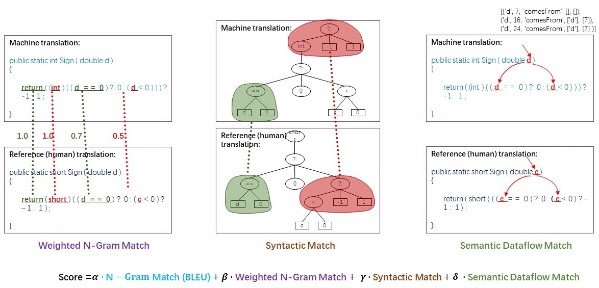

# CodeBLEU
[](https://github.com/k4black/codebleu/actions/workflows/publish.yml)
[](https://github.com/k4black/codebleu/actions/workflows/test.yml)
[](https://codecov.io/gh/k4black/codebleu)
[](https://badge.fury.io/py/codebleu)


This repository contains an unofficial `CodeBLEU` implementation that supports `Linux`, `MacOS` (incl. M-series) and `Windows`. It is available through `PyPI` and the `evaluate` library.

Available for: `Python`, `C`, `C#`, `C++`, `Java`, `JavaScript`, `PHP`, `Go`, `Ruby`, `Rust`.

---

The code is based on the original [CodeXGLUE/CodeBLEU](https://github.com/microsoft/CodeXGLUE/tree/main/Code-Code/code-to-code-trans/evaluator/CodeBLEU) and updated version by [XLCoST/CodeBLEU](https://github.com/reddy-lab-code-research/XLCoST/tree/main/code/translation/evaluator/CodeBLEU).  It has been refactored, tested, built for macOS and Windows, and multiple improvements have been made to enhance usability.

## Metric Description

> An ideal evaluation metric should consider the grammatical correctness and the logic correctness.
> We propose weighted n-gram match and syntactic AST match to measure grammatical correctness, and introduce semantic data-flow match to calculate logic correctness.
>   
[from [CodeXGLUE](https://github.com/microsoft/CodeXGLUE/tree/main/Code-Code/code-to-code-trans/evaluator/CodeBLEU) repo]

In a nutshell, `CodeBLEU` is a weighted combination of `n-gram match (BLEU)`, `weighted n-gram match (BLEU-weighted)`, `AST match` and `data-flow match` scores.

The metric has shown higher correlation with human evaluation than `BLEU` and `accuracy` metrics.


## Installation

CodeBLEU supports Python 3.11 through 3.15 on Linux, macOS, and Windows.
CI tests both ARM and Intel macOS runners.
Tree-sitter 0.26.1 or later in the 0.26 series is required.
Older Python versions are no longer supported.

The metrics is available as [pip package](https://pypi.org/project/codebleu/) and can be installed as indicated above:
```bash
pip install codebleu
```
or directly from git repo (require internet connection to download tree-sitter):
```bash
pip install git+https://github.com/k4black/codebleu.git
```

Also you have to install tree-sitter language you need (e.g. python, rust, etc):
```bash
pip install tree-sitter-python
```
Or you can install all languages:
```bash
pip install codebleu[all]
```

The `all` extra installs compatible grammar releases from PyPI.
Individual grammars must match the versions declared in `pyproject.toml`.
Pip builds packages from source if a compatible wheel is unavailable.
A source build requires a C compiler.

Grammar updates can change AST shapes and metric scores.
Record the CodeBLEU, Tree-sitter, and grammar versions with evaluation results.
See [metric definitions and score changes](docs/metric-semantics.md) before comparing results with earlier releases.

## Usage 

```python
from codebleu import calc_codebleu

prediction = "def add ( a , b ) :\n return a + b"
reference = "def sum ( first , second ) :\n return second + first"

result = calc_codebleu([reference], [prediction], lang="python", weights=(0.25, 0.25, 0.25, 0.25), tokenizer=None)
print(result)
# {
#   'codebleu': 0.7135, 
#   'ngram_match_score': 0.1041, 
#   'weighted_ngram_match_score': 0.7500, 
#   'syntax_match_score': 1.0, 
#   'dataflow_match_score': 1.0
# }
```
where `calc_codebleu` takes the following arguments:
- `references` (`list[str]` or `list[list[str]]`): reference code
- `predictions` (`list[str]`) predicted code
- `lang` (`str`): code language, see `codebleu.AVAILABLE_LANGS` for available languages (python, c_sharp, c, cpp, javascript, java, php, go, ruby, and rust)
- `weights` (`tuple[float,float,float,float]`): weights of the `ngram_match`, `weighted_ngram_match`, `syntax_match`, and `dataflow_match` respectively, defaults to `(0.25, 0.25, 0.25, 0.25)`
- `tokenizer` (`callable`): to split code string to tokens, defaults to `s.split()`

and outputs the `dict[str, float]` with following fields:
- `codebleu`: the final `CodeBLEU` score
- `ngram_match_score`: `ngram_match` score (BLEU)
- `weighted_ngram_match_score`: `weighted_ngram_match` score (BLEU-weighted)
- `syntax_match_score`: `syntax_match` score (AST match)
- `dataflow_match_score`: `dataflow_match` score

Alternatively, you can use `k4black/codebleu` from HuggingFace Spaces (`codebleu` package required):
```python
import evaluate
metric = evaluate.load("dvitel/codebleu")

prediction = "def add ( a , b ) :\n return a + b"
reference = "def sum ( first , second ) :\n return second + first"

result = metric.compute([reference], [prediction], lang="python", weights=(0.25, 0.25, 0.25, 0.25))
```

Feel free to check the HF Space with online example: [k4black/codebleu](https://huggingface.co/spaces/k4black/codebleu) 


## Contributing

Contributions are welcome!  
If you have any questions, suggestions, or bug reports, please open an issue on GitHub.

Make your own fork and clone it:
```bash
git clone https://github.com/k4black/codebleu
```

For development, create a virtual environment and install the language and test extras:
```bash
python -m venv .venv
# Activate the virtual environment for your shell.
python -m pip install -e ".[all,test]"
```

For testing just run pytest:
```bash
python -m pytest
```

To perform a style check, run:
```bash
python -m isort codebleu tests --check
python -m black codebleu tests --check
python -m ruff check codebleu tests
python -m mypy codebleu
```


For a release, first merge a PR that updates `VERSION` and `CHANGELOG.md`.
Publish a GitHub release from that commit with a tag that matches `VERSION`.
The publish workflow checks the version and builds from the release tag.
The workflow does not change the protected branch or move tags.


## License

This project is licensed under the terms of the MIT license.


## Citation

Official [CodeBLEU paper](https://arxiv.org/abs/2009.10297) can be cited as follows:
```bibtex
@misc{ren2020codebleu,
      title={CodeBLEU: a Method for Automatic Evaluation of Code Synthesis}, 
      author={Shuo Ren and Daya Guo and Shuai Lu and Long Zhou and Shujie Liu and Duyu Tang and Neel Sundaresan and Ming Zhou and Ambrosio Blanco and Shuai Ma},
      year={2020},
      eprint={2009.10297},
      archivePrefix={arXiv},
      primaryClass={cs.SE}
}
```
